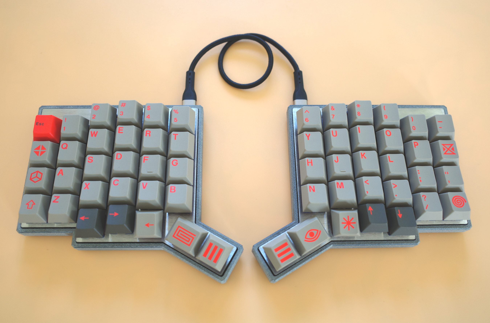

# pando-rmk

RMK firmware for the [**Pando**](https://github.com/jyap808/pando) split keyboard (STM32G0B1KB).



The Pando is not a two-MCU split: the left half is wired directly to the
MCU and the right half is a **PCA9555 I2C I/O expander**. The firmware
therefore scans both halves itself instead of using RMK's split transport.

## Features

- 5x12 matrix: left half on direct GPIO, right half on a PCA9555 at `0x20`.
- Left half works standalone. A missing right half is probed every 2 s and
  any right-half keys held at disconnect are released.
- Vial support (8 layers, same Vial UID and `vial.json` as the QMK build).
- Keymap and settings persisted in the top flash sectors.

## Hardware

| Function | Pins |
| --- | --- |
| Left rows (outputs) | `PB0`, `PB1`, `PB2`, `PA8`, `PA9` |
| Left columns (inputs, pull-up) | `PA7`, `PA6`, `PA2`, `PA3`, `PA4`, `PA5` |
| I2C1 SCL / SDA | `PB6` / `PB7` (AF6, 400 kHz) |
| USB | `PA11` (DM), `PA12` (DP) |

PCA9555 registers used:

- `INPUT0` (`0x00`) — right-half columns.
- `OUTPUT1` (`0x03`) — right-half rows (idle high, driven low per row).
- `CONFIG0` (`0x06`) = `0xFF` — columns are inputs.
- `CONFIG1` (`0x07`) = `0x00` — rows are outputs.

The right-half PCB columns are reverse-wired: expander bit `c` maps to
matrix column `11 - c`, exactly as in the QMK firmware.

## Clocks

- SYSCLK: 64 MHz from HSI16 (PLL M=2, N=16, R=2).
- USB: HSI48 with CRS synced to USB SOF.
- I2C1 kernel clock: PCLK, 64 MHz.

At boot D+ is held low for 100 ms before the USB driver starts. This is
the Mac silicon (M3/M4) re-enumeration workaround from the QMK firmware.

## Build

```sh
cargo build --release
```

The binary is at
`target/thumbv6m-none-eabi/release/pando-rmk`.

`memory.x` reserves the top 8 KiB of the 128 KiB flash for RMK storage
(2 x 2 KiB sectors plus headroom), so the linker keeps firmware below
`0x0801E000`. The current image is well under that.

## Flash

Put the board in DFU mode (hold the boot/reset button while plugging in),
then either run:

```sh
cargo run --release
```

or do the two steps by hand:

```sh
arm-none-eabi-objcopy -O binary \
  target/thumbv6m-none-eabi/release/pando-rmk \
  target/thumbv6m-none-eabi/release/pando-rmk.bin
dfu-util -a 0 -s 0x08000000:leave -D target/thumbv6m-none-eabi/release/pando-rmk.bin
```

`scripts/flash.sh` is the cargo runner and performs both steps. Do not pass
the ELF to `dfu-util` directly: it would flash the ELF header as raw data.

## Vial

`vial.json` is the Pando definition from the QMK firmware. It is
pre-compressed with `xz` into `vial.json.xz` and embedded directly, which
avoids a build-time `liblzma`/`pkg-config` dependency.

If you edit `vial.json`, regenerate the blob:

```sh
xz -c -6 vial.json > vial.json.xz
```

The Vial unlock combo is matrix `(0,0)` + `(0,1)`.

## License

Firmware source is licensed under GPL-2.0-or-later. See `LICENSE`.
